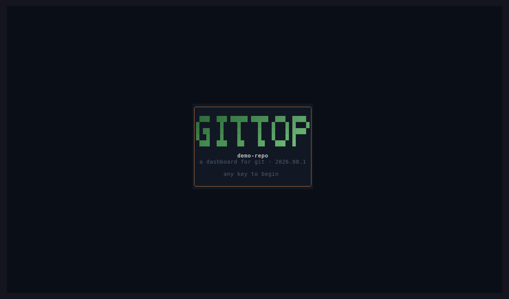

<div align="center">


# gittop

**A btop-style terminal dashboard for Git and CI.**

<p>
  
  
  
  
  
  
  
</p>



</div>

---

gittop shows your working tree, commit history, CI runs and pull requests on one screen. The local
views read the repository through libgit2 and work offline. The remote views talk to GitHub and
GitLab, and fall back to local-only when there is no token, remote or connection.

## Install

On Linux (x86_64, glibc 2.35+):

```bash
curl -fsSL https://raw.githubusercontent.com/sinhaparth5/gittop/master/install.sh | sh
```

This installs to `~/.local/bin` without sudo and checks the download against `SHA256SUMS`. Run it
again to update. `GITTOP_PREFIX` changes the location and `GITTOP_VERSION` pins a release.

Or download a [release](https://github.com/sinhaparth5/gittop/releases) by hand:

```bash
sudo apt install ./gittop_*_amd64.deb    # Ubuntu 22.04+, Debian 12+
tar xzf gittop-*-linux-x86_64.tar.gz     # any other distro: put bin/gittop on your PATH
```

On Windows, use the `.exe` installer (it can add gittop to `PATH`) or the `.zip` (no admin needed).
Run it in Windows Terminal for full colour. WSL works with the `.deb`.

## Views

`1`–`9` and `0` jump to a tab, `tab` cycles.

- **Status**: stage, unstage, discard and commit files.
- **History**: commit log with a lane graph and a 91-day activity heatmap.
- **Branches**: ahead/behind counts, checkout, and pruning of deleted upstreams.
- **Graph**: commits over time by day, week or month, plus top authors and hours.
- **Diff**: unstaged, staged, or any commit's diff.
- **Stashes**: stash, apply, pop and drop.
- **Remote**: repository info and remaining API budget, across multiple remotes.
- **CI**: GitHub Actions runs and GitLab pipelines, filterable by branch or tag, with jobs on `enter`.
- **Pull requests**: open PRs/MRs with details, and `n` to open a new one.
- **Settings**: theme, glyphs, border, animations, sign-in. Changes save immediately.

`W` opens worktrees and submodules. `/` filters whichever list is on screen. `B` rebases onto the
upstream, and `o` continues or aborts an interrupted rebase, merge or cherry-pick. `b` on a file
opens blame, `z` undoes the last change to HEAD and `Z` opens the reflog. Press `?` for every key,
including interactive rebase, cherry-pick, amend and branch/tag management.

## Push and pull

`f` fetches, `p` pulls, `P` pushes, `esc` cancels. Pull only fast-forwards. Push never forces and
asks first. Over ssh, gittop uses your system `ssh`, so your config, agent and keys apply.

## Tokens and sign-in

Public repositories need no token. A token raises GitHub's limit from 60 to 5000 requests an hour
and unlocks private repositories. Press `L` to sign in, or set one in the environment:

```bash
export GITHUB_TOKEN=ghp_...      # or GH_TOKEN, or GITTOP_TOKEN for either provider
export GITLAB_TOKEN=glpat-...    # or CI_JOB_TOKEN
```

Signing in saves the token to the config file, readable only by you. gittop never prints a token.

## Config

```bash
gittop --init-config    # write a commented starter
gittop --config-path    # print where it looks
```

```toml
[theme]
name = "btop"         # mainframe, default, catppuccin, gruvbox, nord, tokyo-night, dracula, daylight, accessible
icons = "auto"        # auto, ascii, unicode, nerd
logos = false         # real GitHub/GitLab marks; needs a Nerd Font
border = "rounded"    # rounded, light, heavy, double
animations = true

[layout]
views = "status diff history branches stashes"
start_view = "status"
compact = false

[general]
auto_refresh = true

[keys]                # rebind any action by name

[[commands]]          # your own commands on keys
key = "ctrl-f"
scope = "branches"
run = ["git", "fetch", "{remote}", "{branch}"]
confirm = true
```

`t` cycles themes. `accessible` keeps the status colours apart for colour-blind users, and every
status also has a glyph and letter. Custom commands run without a shell and support `{branch}`,
`{commit}`, `{file}` and `{remote}`.

## Keys

| Key               | Action                                                       |
| ----------------- | ------------------------------------------------------------ |
| `1`–`9` `0`       | Jump to a tab                                                |
| `tab`             | Cycle views                                                  |
| `j` `k` / arrows  | Move                                                         |
| `g` `G`           | First / last                                                 |
| `ctrl-u` `ctrl-d` | Page up / down                                               |
| `/`               | Filter                                                       |
| `enter`           | Open (diff, CI jobs, PR details, checkout)                   |
| `space` `s` `u`   | Toggle / stage / unstage                                     |
| `a`               | Stage all                                                    |
| `d`               | Discard                                                      |
| `c`               | Commit                                                       |
| `S`               | Stash                                                        |
| `a` `p` `d`       | Stash view: apply / pop / drop                               |
| `[` `]`           | Diff view: previous / next file                              |
| `h` `l` `d` `w` `m` | Graph: pan, and bucket by day / week / month               |
| `B` `o`           | Rebase / continue or abort                                   |
| `f` `p` `P`       | Fetch / pull / push                                          |
| `x`               | Branches view: prune                                         |
| `b`               | CI view: pick a ref                                          |
| `n`               | Pulls view: open a PR                                        |
| `W`               | Worktrees and submodules                                     |
| `R`               | Next remote                                                  |
| `L`               | Sign in                                                      |
| `t`               | Next theme                                                   |
| `r`               | Reload                                                       |
| `?`               | Help                                                         |
| `q`               | Quit                                                         |

Mouse works too: scroll, click to select, click again to open.

## Building

Needs a C++20 compiler, CMake 3.24+, zlib and libcurl. FTXUI, libgit2 and nlohmann/json are fetched
by CMake.

```bash
sudo apt install libcurl4-openssl-dev
cmake -B build -DCMAKE_BUILD_TYPE=Release
cmake --build build -j
./build/gittop [path]
ctest --test-dir build
```

On Windows (Visual Studio 2022+):

```
cmake -B build -DCMAKE_BUILD_TYPE=Release -DCMAKE_MSVC_RUNTIME_LIBRARY=MultiThreaded
cmake --build build --config Release
```

`scripts/build-windows.sh --run` cross-compiles from Linux and runs it under Wine (needs Docker).

Planned work is in [issues](https://github.com/sinhaparth5/gittop/issues); shipped work is in
[CHANGELOG.md](CHANGELOG.md).

## License

GPL-3.0. See [LICENSE](LICENSE).
